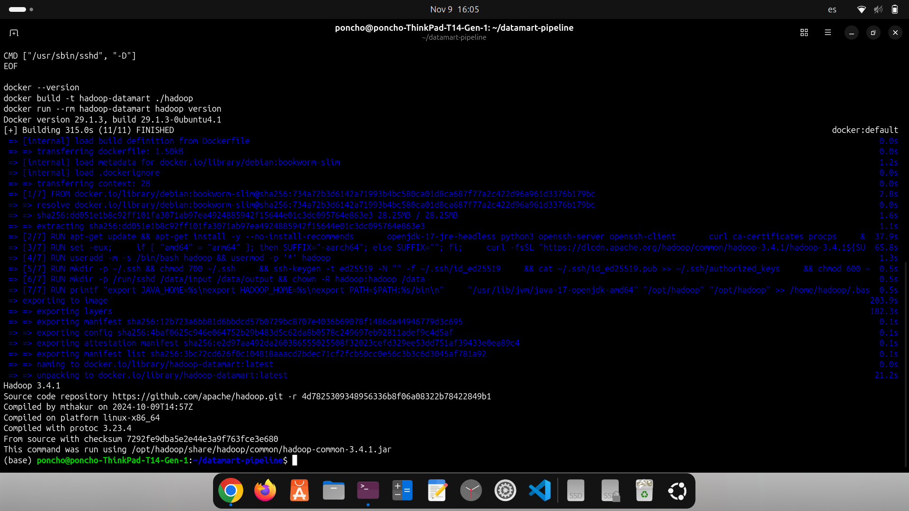
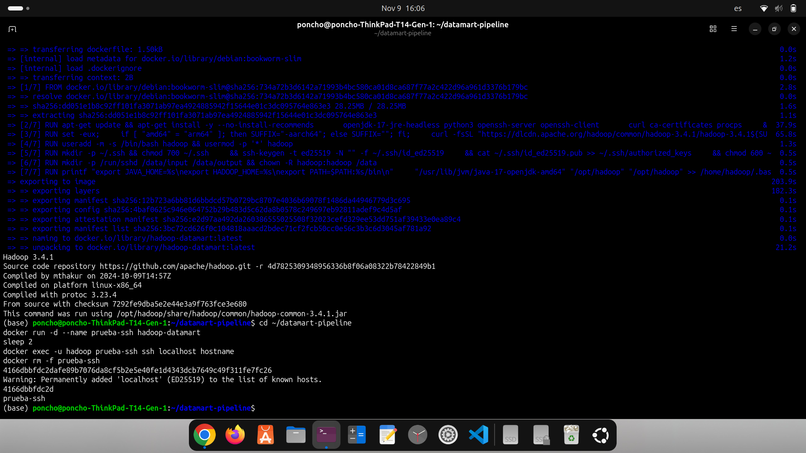
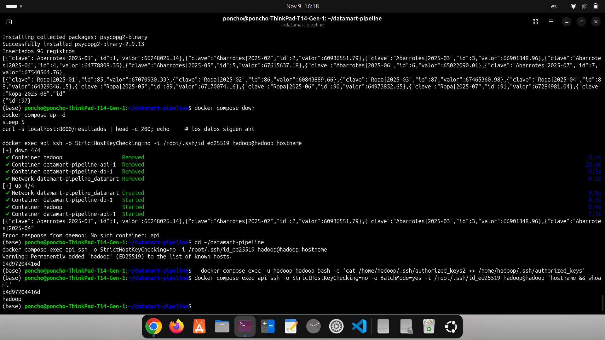
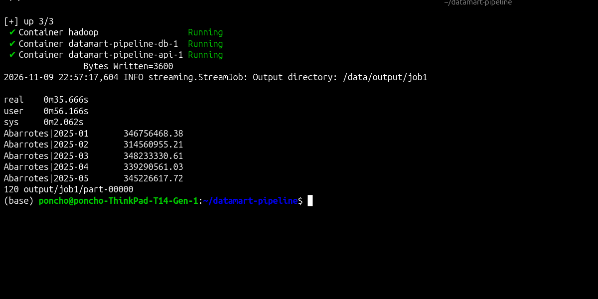
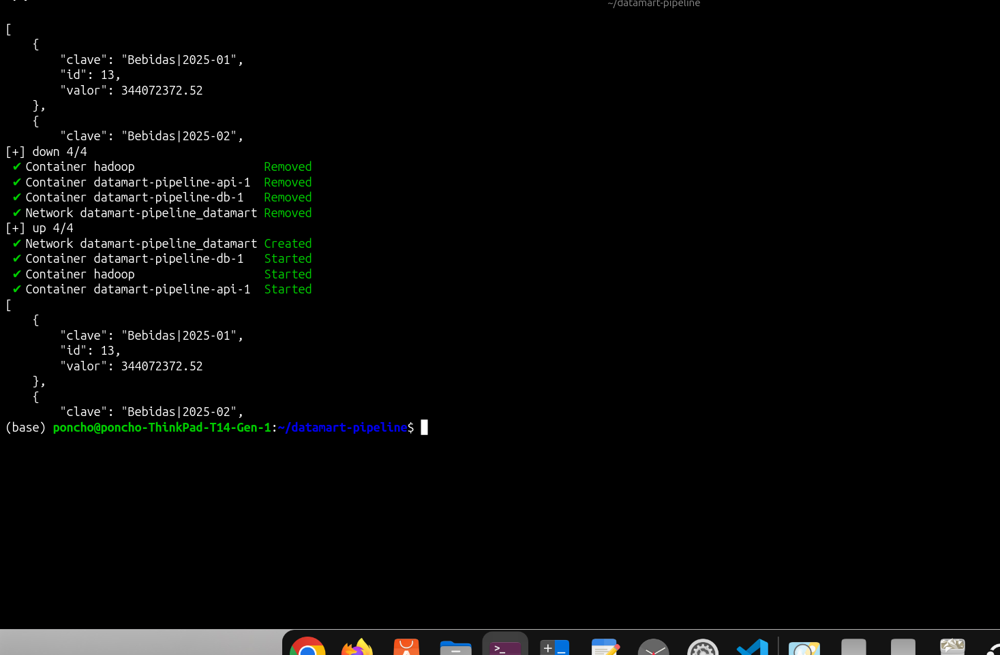

# Pipeline de datos contenerizado: DataMart

**Materia:** Manejo Masivo de Datos (Big Data), Segundo Parcial
**Alumno:** Alfonso Salazar FLores
**Matrícula:** 125053920
**Pregunta asignada (último dígito 0):** ingreso total (`cantidad × precio_unitario`) por categoría y mes.

## Arquitectura

Tres servicios en la red `datamart`:

| Servicio | Imagen | Función |
|---|---|---|
| `hadoop` | Dockerfile propio (Debian + Java 17 + Python 3 + Hadoop 3.4.1 standalone + OpenSSH) | Ejecuta el job MapReduce |
| `db` | `postgres:16` con volumen nombrado `pgdata` | Guarda los resultados |
| `api` | Flask (Python 3.12) | Expone los resultados y el CRUD |

El dataset se monta como volumen de solo lectura en `/data/input`.

## Cómo reproducir

```bash
git clone https://github.com/AlfonsoT800/datamart-pipeline.git && cd datamart-pipeline

# 1. Dataset (script del profesor, con tu matrícula como semilla)
python3 generar_dataset.py 125053920   # genera data/ventas.csv

# 2. Llave SSH, carpetas y .env
./setup.sh

# 3. Levantar todo
docker compose up --build -d

# 4. Job MapReduce (Hadoop Streaming)
rm -rf output/job1
docker exec -u hadoop hadoop bash -c '
  cd ~/mapreduce &&
  time /opt/hadoop/bin/hadoop jar /opt/hadoop/share/hadoop/tools/lib/hadoop-streaming-3.4.1.jar \
    -files mapper.py,reducer.py \
    -mapper "python3 mapper.py" \
    -reducer "python3 reducer.py" \
    -input /data/input/ventas.csv \
    -output /data/output/job1'

# 5. Cargar resultados a PostgreSQL
pip install psycopg2-binary
set -a; source .env; set +a
DB_HOST=localhost python3 cargar_resultados.py

# 6. Consultar la API
curl localhost:8000/resultados
curl localhost:8000/resultados/Bebidas
```

Para comprobar la persistencia: `docker compose down` y luego `docker compose up -d`. Los datos siguen ahí.

## Evidencias

### A1. `hadoop version`


### B. SSH sin contraseña
`ssh localhost` dentro del contenedor `hadoop`:


Desde `api` hacia `hadoop` (con `BatchMode=yes`, que falla si pidiera contraseña):


### C1. Salida del job MapReduce
120 filas (10 categorías × 12 meses).


### D. Respuesta de la API y persistencia



## Comparativa de rendimiento (C2)

| Método | Tiempo (`real`) |
|---|---|
| Script secuencial (Python, `csv`) | TIEMPO_SECUENCIAL |
| Hadoop Streaming (standalone) | TIEMPO_HADOOP |

Ambos resultados son idénticos (`diff` sin diferencias, 120 líneas).

El script secuencial fue más rápido que Hadoop. En modo standalone Hadoop corre en una sola máquina, así que no hay nodos que repartan el trabajo, pero sí paga costos fijos: arranque de la JVM, planificación del job, ordenamiento y shuffle en disco entre mapper y reducer, y la ejecución del mapper y reducer en Python como procesos externos. Con un archivo de unos cientos de MB, que cabe sin problema en un solo equipo, esos costos pesan más que cualquier beneficio. MapReduce conviene con volúmenes de decenas o cientos de GB, distribuidos en un cluster con HDFS, donde el paralelismo compensa la sobrecarga.

## Decisiones de diseño

- El mapper ignora el encabezado y las líneas mal formadas con `continue`, para que una línea mala no tumbe el job.
- Los montos se manejan en centavos enteros para evitar errores de punto flotante, así Hadoop y el script secuencial coinciden exactamente.
- La llave SSH se genera con `ssh-keygen -N ""` en `setup.sh`: no hay contraseñas en ningún Dockerfile ni en el repo.
- `.env`, `ssh/`, `output/` y el CSV están en `.gitignore`. Se incluye `.env.example` como plantilla.

## Teoría (Parte E)

1. **Modos de Hadoop.** En *standalone* todo corre en un solo proceso Java, sin demonios y sin HDFS (usa el sistema de archivos local). En *pseudo-distribuido* corren los demonios (NameNode, DataNode, ResourceManager) en una sola máquina, cada uno en su proceso. En *totalmente distribuido* los demonios se reparten entre varios nodos de un cluster. HDFS se usa en pseudo-distribuido y en distribuido.

2. **Volumen vs COPY.** El CSV pesa cientos de MB y haría la imagen enorme y lenta de construir y subir. Además, cada alumno tiene un dataset distinto y con un volumen se cambia sin reconstruir la imagen. Con `:ro` se protege el original, y los datos no viajan dentro de la imagen ni del repositorio.

3. **`down` vs `down -v`.** `docker compose down` elimina contenedores y red, pero el volumen nombrado `pgdata` se conserva y los datos de la base siguen ahí. `docker compose down -v` también borra los volúmenes, así que se pierden los datos y hay que recargar los resultados.

4. **MapReduce vs secuencial.** Con 336 MB el costo fijo de Hadoop (arranque de la JVM, planificación, ordenamiento y shuffle en disco) pesa más que el paralelismo, y en standalone no hay varios nodos; por eso el secuencial tardó 15 s y Hadoop 36 s. Conviene con datos de decenas o cientos de GB que no caben en una máquina o tardan demasiado, con un cluster y HDFS que reparta el cómputo cerca de los datos.

5. **CMD/ENTRYPOINT y COPY/ADD.** `CMD` es el comando por defecto y se reemplaza fácil con `docker run imagen otro-comando`; `ENTRYPOINT` es el ejecutable fijo y lo que se pasa al `run` se agrega como argumentos. `COPY` solo copia archivos locales a la imagen; `ADD` además descomprime tarballs locales y acepta URLs, por eso se prefiere `COPY` salvo que se necesite eso.

## Estructura del repo

```
.
├── docker-compose.yml
├── .env.example
├── setup.sh
├── cargar_resultados.py
├── generar_dataset.py
├── hadoop/Dockerfile
├── mapreduce/ (mapper.py, reducer.py, secuencial.py)
├── api/ (Dockerfile, app.py, requirements.txt)
├── db/init.sql
├── docs/ (capturas)
└── README.md
```
